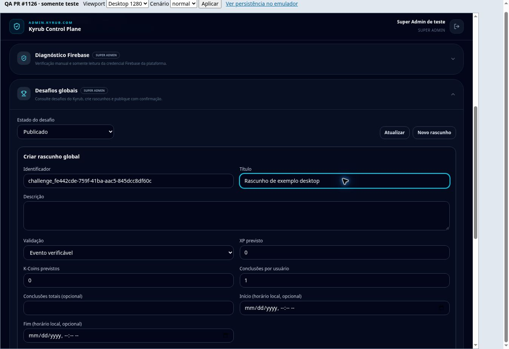
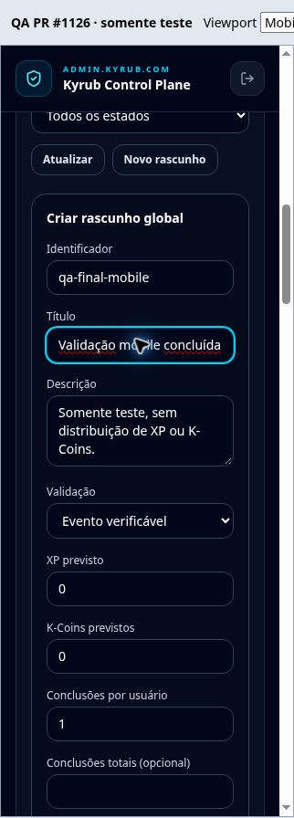
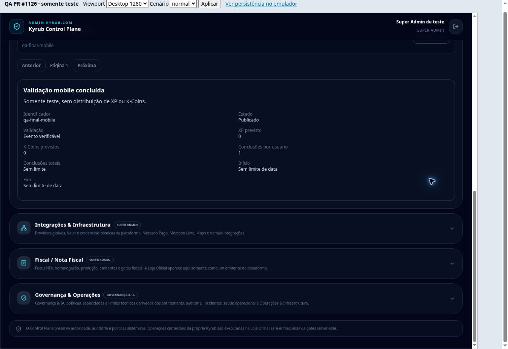
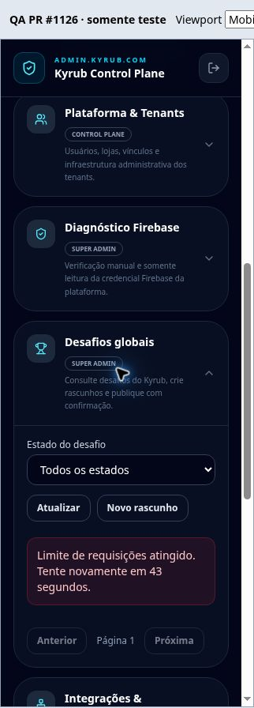

# PR #1126 - validação visual e funcional

Data: 11/11/2026. Base inspecionada: `f040110`; dependência não integrada: #1124
(`e128888`). Branch: `feat/global-challenge-control-plane`. Este registro acompanha
as correções incrementais do mesmo branch. A PR permanece em rascunho.

## Ambiente e alcance

Chrome real em HTTPS de Sandbox descartável, com cópia do repositório e Firestore
Emulator `demo-kyrub-control-plane`. Após instalar dependências, a saída de rede do
Sandbox foi bloqueada. Nenhuma credencial ou sessão de produção foi usada. O
Sandbox foi encerrado após as capturas; não é um preview Vercel nem um deploy.

O host reproduz a navegação e componentes reais do Control Plane, CSS compilado,
cliente HTTP, handler, verificador JWT, autorização, cotas, repositório e transações.
Somente a sessão/perfil Firebase do navegador e os módulos alheios ao escopo são
substituídos no bundle de QA. Tokens RSA e certificado de teste são gerados em
memória; a assinatura, projeto, expiração e perfil persistido são verificados pelo
servidor real. Não representa uma validação do login Google/OAuth ou da obtenção de
certificados Google. O harness nunca integra os entrypoints da aplicação.

Desktop: iframe com viewport CSS 1280x900. Mobile: 390x844 e 320x844 em Chrome,
sem simular Safari, hardware, teclado virtual ou toque de um aparelho físico.
As capturas completas incluem a barra externa de QA; os recortes mobile retiram
apenas a área vazia externa, sem redesenhar a aplicação.

## Resultados observados no navegador

| Fluxo | Evidência / resultado |
| --- | --- |
| Navegação administrativa | Accordion real abre Desafios globais; identidade de teste visível no desktop |
| Lista e paginação | Primeira página com 20 itens; segunda com 6; anterior retorna à primeira |
| Filtros | Publicado retorna somente publicados; Cancelado retorna estado vazio |
| Consulta individual | Dados, limites, período e estado corretos; foco e rolagem nos detalhes após correção |
| Criação desktop | `qa-visual-desktop`, XP definido 25 e K-Coins 0; apenas rascunho salvo |
| Confirmação | Cancelar mantém rascunho; aceitar publica; texto contextual contém o título |
| Publicação | Estado Publicado e botão removido; consulta posterior consistente |
| Erro 400 | Publicar `qa-002`, com período vencido, exibe orientação de revisão |
| Erro 409 | Criar novamente `qa-001` exibe conflito; mantém formulário e identificador |
| Erro 401 | Token assinado expirado bloqueado; alerta de sessão expirada e dados removidos |
| Erro 403 | Perfil do servidor sem Super Admin bloqueado mesmo com perfil antigo no cliente |
| Erro 429 | Cota real pré-esgotada retorna espera de 43 segundos via Retry-After |
| Carregamento | GET atrasado 20s; mensagem, aria-busy=true e paginação/atualização desabilitadas |
| Mobile 390 | Lista, quebra de títulos e detalhes; documento 375/375px (cliente/scroll) |
| Mobile 320 | Formulário preenchido, criado e publicado após correção; documento 305/305px |
| Desktop final | Formulário em duas colunas, campos contidos e consulta do item criado no mobile |
| Acessibilidade básica | Labels e nomes acessíveis, foco visível, Tab do título à descrição; alertas focados; status e busy expostos |

Não é certificação WCAG nem teste com leitor de tela. A confirmação nativa foi
inspecionada e acionada, mas o navegador de revisão não permite capturá-la enquanto
aberta. Os estados antes/depois e a persistência comprovam o fluxo.

## Problemas corrigidos

1. **Detalhes fora da tela:** no código-base, ao abrir o primeiro item, a seção
   iniciava em y=2348px, abaixo dos 20 resultados, sem foco. Agora o título recebe
   foco e rolagem com margem para o cabeçalho fixo; observado em y=143px no desktop.
   Teste React DOM passou a exigir foco no título após a consulta.
2. **Campos ultrapassando o cartão em 320px:** a largura mínima intrínseca do
   fieldset/grade avançava além do espaço interno, sem necessariamente provocar
   scroll no documento. Aplicados min-w-0 nos campos/fieldset e uma coluna explícita
   no mobile. Conferência final: cartão x=33..272; todos os 10 controles x=50..255
   (205px), preservando as duas colunas no desktop.

## Persistência e regressões

O receipt do fluxo mobile final retornou:

```json
{"project":"demo-kyrub-control-plane","id":"qa-final-mobile","status":"published","events":["created","published"],"collections":["global_challenges","kyrub_admin"]}
```

O fluxo desktop anterior também registrou exatamente `created` e `published` para
`qa-visual-desktop`. Não houve emissão de XP/K-Coins ou criação de ledger de
recompensas. As fixtures foram descartadas junto com o Sandbox.

| Verificação automatizada | Resultado |
| --- | --- |
| `npm run test:global-challenges` final | 50 aprovados, zero falhas/skips: 41 API/emulador + 9 UI/cliente/segurança do harness |
| Revogação e repetição automática | Cenários existentes mantidos: rollback, concorrência, auditoria e idempotência |
| Guardas do harness | Recusa antes da inicialização: flag ausente, projeto indevido, emulador remoto ou arquivo de credenciais |
| `npm run prebuild` final | 2561 aprovados; TypeScript e contrato MVP incluídos |
| Build | Vite + servidor aprovados; avisos existentes de chunks/CJS permanecem |
| `git diff --check` | Aprovado |

Reprodução e limites do host: [scripts/qa/README.md](../scripts/qa/README.md).
Nenhuma dependência nova foi adicionada. O CI do novo commit deve ser observado na
PR; resultados locais não são apresentados como resultado do CI.

## Capturas

Desktop, formulário final:



Mobile 320, formulário corrigido (recorte):



Consulta do desafio publicado no desktop:



Limite de requisições no mobile (recorte):



## Parecer

O bloqueio de validação visual foi resolvido e os dois defeitos encontrados foram
corrigidos e verificados. Pronta para revisão final de código/segurança, mantendo
Draft e a dependência #1124. Revisão independente de segurança e aprovação da
base ainda são necessárias para integração. Não há autorização de merge/deploy.
Não foram alterados planos, Pix, lojas, flags de produção ou distribuição de
recompensas, nem feitas cobranças reais.
